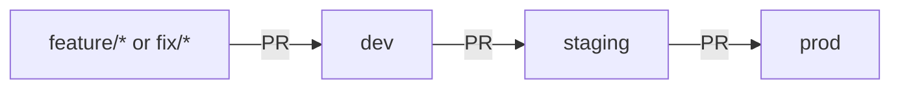

# CodeFast SaaS: Cloud Build Log #1

> Taking a full-stack SaaS app from "runs on my laptop" to a containerized,
> CI/CD-deployed service on AWS, built step by step and documented as I go.

## About This Project

This is part of my **Cloud Build Log**, a series where I take an application
through the full DevOps lifecycle and document the decisions I made and
the problems I hit along the way.

I used AI (Claude) to assist me while building this project. I also used it
to intentionally introduce realistic errors as I built, so I'd learn to
diagnose and fix them. The problems labeled "a deliberate debugging exercise"
in each phase's write-up came from that.

The app is a feedback board where users post ideas and vote on them
(Next.js, MongoDB, Auth.js, Stripe). It started as a course project; the
containerization, pipelines, and infrastructure are my own work.

## What This Project Demonstrates

- **Containerization:** multi-stage Docker build (1.06 GB → 336 MB), non-root user, no package managers in the runtime image, health checks
- **Environment promotion:** dev → staging → prod, with every change going through a PR
- **Runtime configuration:** one image, configured per environment, with no secrets baked in
- **CI:** GitHub Actions runs lint (warnings fail the build), a cached Docker build, a container smoke test, and a Trivy vulnerability scan (HIGH/CRITICAL fail the build) on every PR
- **Branch protection:** `dev`, `staging`, and `prod` accept changes only through PRs with passing checks
- **Dependency updates:** weekly Dependabot PRs into `dev`, promoted like any other change
- **Infrastructure as code:** Terraform for the whole AWS environment, split into a long-lived bootstrap stack and a dev stack that's created and destroyed every session, with remote state in S3 (versioned, encrypted, native locking)
- **Cloud deployment:** ECS Fargate behind an Application Load Balancer, HTTPS with an ACM certificate, and a subdomain delegated from Cloudflare to Route 53
- **Secrets management:** app secrets in SSM Parameter Store, injected at container start, never in git, the image, or Terraform state
- **Least privilege:** IAM Identity Center (SSO) instead of access keys, separate ECS execution and task roles, security groups that only let the load balancer reach the app
- **Cost control:** a $10 budget alarm created before anything else, no NAT gateway, and teardown after every session. Phase 3 cost under $1 in AWS charges
- **CD:** merging a PR deploys that branch's environment (build → push to ECR → `terraform apply` → health check) through GitHub OIDC with no stored AWS keys. Prod waits for a required reviewer, and a nightly workflow tears every environment down
- **Monitoring and alerting:** six CloudWatch alarms and a dashboard per environment (availability, errors, saturation, and a log-based alarm), emailing through SNS on both failure and recovery, and proven with a failure test
- **Debugging:** real problems I hit, and how I diagnosed and fixed them (see each phase's write-up)

## Project Phases

Each phase has its own write-up covering the design decisions and the
problems I solved, plus a pull request into `dev` with the actual changes.

| Phase                                                           | Status  | Write-up                                                             |
| --------------------------------------------------------------- | ------- | -------------------------------------------------------------------- |
| 1. Containerization with Docker and Docker Compose              | ✅ Done | [docs/phase-1-containerization.md](docs/phase-1-containerization.md) |
| 2. CI with GitHub Actions (lint, build, smoke test, image scan) | ✅ Done | [docs/phase-2-ci.md](docs/phase-2-ci.md)                             |
| 3. AWS infrastructure with Terraform                            | ✅ Done | [docs/phase-3-infrastructure.md](docs/phase-3-infrastructure.md)     |
| 4. Continuous deployment (dev → staging → prod)                 | ✅ Done | [docs/phase-4-cd.md](docs/phase-4-cd.md)                             |
| 5. Monitoring and alerting                                      | ✅ Done | [docs/phase-5-monitoring.md](docs/phase-5-monitoring.md)             |

## Tech Stack

| Layer      | Tools                                                     |
| ---------- | --------------------------------------------------------- |
| App        | Next.js 15, React 19, MongoDB (Mongoose), Auth.js, Stripe |
| Containers | Docker (multi-stage), Docker Compose                      |
| CI/CD      | GitHub Actions, GitHub Environments, OIDC to AWS          |
| Cloud      | AWS (ECS Fargate, ALB, ECR, Route 53, ACM, SSM, S3), Terraform |
| Monitoring | CloudWatch (alarms, dashboards, log metric filters), SNS      |
| DNS        | Cloudflare (domain), Route 53 (delegated `project1` subdomain) |

## Branching Strategy



- New work happens on a short-lived `feature/*` or `fix/*` branch.
- Changes merge into `dev` through a pull request.
- Changes are promoted `dev` → `staging` → `prod`, each through its own PR.
- Each branch maps to its own environment, and **merging into it deploys
  it**: `dev` → `dev.project1.keshawnbarbary.com`, `staging` →
  `staging.project1.keshawnbarbary.com`, `prod` →
  `project1.keshawnbarbary.com` (after approval).

**Why I chose this:** environment branches make it easy to see what is
running where. The `prod` branch _is_ production. The tradeoff is that each
branch builds its own image, so staging and prod aren't guaranteed to run the
exact same artifact. The alternative is trunk-based development: one `main`
branch, where the pipeline builds the image once and promotes that same image
through each environment. I plan to use that model in a later Build Log
project to compare the two.

## Run It Locally

**Prerequisites:** [Docker Desktop](https://www.docker.com/products/docker-desktop/),
[Stripe CLI](https://docs.stripe.com/stripe-cli), a Stripe account in test
mode, and Google OAuth credentials.

1. Clone the repo:
   ```bash
   git clone https://github.com/keshawndev/code-fast-saas.git
   cd code-fast-saas
   ```
2. Copy the example env file and fill in your values:
   ```bash
   cp .env.example .env.local
   ```
   Docker Compose sets `MONGO_URI`, `AUTH_URL`, and `AUTH_TRUST_HOST` for you.
3. Start the app and a local MongoDB:
   ```bash
   docker compose up --build
   ```
4. In a second terminal, forward Stripe webhooks to the container:
   ```bash
   stripe listen --forward-to localhost:3000/api/webhook
   ```
   Put the `whsec_...` secret it prints into `STRIPE_WEBHOOK_SECRET` in
   `.env.local`, then restart the app with
   `docker compose up -d --force-recreate app`.
5. Open http://localhost:3000. To test a subscription, use Stripe's test card
   `4242 4242 4242 4242` with any future expiration date and any CVC.

Stop everything with `docker compose down`. Add `-v` to also delete the
local database.

## Deploy to AWS

Deploys run from GitHub Actions. The full design, results, and problems are
in the [Phase 3](docs/phase-3-infrastructure.md) and
[Phase 4](docs/phase-4-cd.md) write-ups.

**Everyday use:**

- **Deploy:** merge a PR into `dev`, `staging`, or `prod`. The `Deploy` job
  in `ci.yml` builds and pushes the image, runs `terraform apply` for that
  environment, and checks `/api/health`. Prod waits for approval under
  **Actions → the run → Review deployments**.
- **Tear down:** **Actions → Destroy → Run workflow**, then pick an
  environment or `all`. A scheduled run also destroys every environment at
  07:00 UTC.
- **Change a secret:** update it in SSM under `/code-fast-saas/<env>/`, then
  redeploy (merge, or re-run the latest deploy). ECS only reads secrets when
  a task starts.

**One-time setup** for a new AWS account:

1. **Bootstrap** (budget alarm, state bucket, ECR, Route 53 zone,
   certificate, GitHub OIDC provider and roles): copy
   `infra/bootstrap/terraform.tfvars.example` to `terraform.tfvars`. The
   backend bucket doesn't exist yet, so comment out the `backend "s3"` block
   in `versions.tf`, run `terraform init` and `terraform apply` in
   `infra/bootstrap/`, then restore the block (with your account ID in the
   bucket name) and run `terraform init -migrate-state`.
2. **GitHub Environments:** `dev`, `staging`, `prod` (each limited to its
   own branch, with prod requiring a reviewer) and `teardown`, each with an
   `AWS_ROLE_ARN` variable from the bootstrap outputs, plus a
   `STRIPE_PRICE_ID` repository variable.
3. **Secrets per environment:** `scripts/setup-env-secrets.sh <env>` seeds
   SSM and creates the Stripe webhook (dev's secrets are set up first, by
   hand). Add each hostname's redirect URI to the Google OAuth client.
