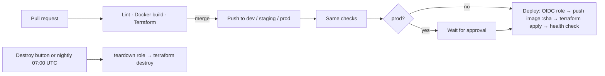

# Phase 4: Continuous Deployment

**Goal:** a merge deploys itself. Merging into `dev`, `staging`, or `prod`
builds the image, pushes it to ECR, and applies that environment's Terraform,
with no AWS keys stored in GitHub. Prod waits for a manual approval.

**Pull requests:** #28–#36 into `dev`, promoted in #37 (staging) and #38
(prod).

**Result:** merging a PR deploys that branch's environment end to end, from
the image to the infrastructure to a health check, with no stored AWS keys.
One promotion took the same change through dev, staging, and prod, and prod
deployed only after I approved it in GitHub.

## Pipeline

## Results

| | Before | After |
| --- | --- | --- |
| How a change reaches AWS | `terraform apply` and `docker push` from my laptop | Merging a PR. The pipeline builds, pushes, applies, and health-checks |
| AWS credentials in GitHub | n/a | None. GitHub OIDC tokens are exchanged for 1-hour role credentials |
| Environments | dev only | dev, staging, and prod from one module, each with its own state, role, domain, database, and secrets |
| Prod release gate | n/a | Required reviewer in GitHub. The approval is recorded on the run (`keshawndev`, approved, `prod`) |
| First deploy (creates the environment) | n/a | 4m19s (dev), 4m6s (staging), 4m5s (prod) |
| Update deploy (rolling, no downtime) | n/a | 3m10s |
| Teardown | `terraform destroy` by hand | Button or nightly schedule: 27 resources per environment, all three in parallel |
| Checks required to merge | Lint, Docker build | Lint, Docker build, Terraform (`fmt` + `validate` on every stack) |
| AWS spend in October | n/a | $0.72 so far (budget data, which lags about a day) |

## Decisions

- **Ephemeral environments.** Merges create or update an environment, and a
  scheduled workflow destroys all of them every night (plus a manual destroy
  button). An always-on environment costs about $35–40/month (load balancer,
  Fargate, public IPs), so three of them would blow past the $10 budget.
- **One domain per environment** in the existing Route 53 zone:
  `dev.project1.keshawnbarbary.com`, `staging.project1.keshawnbarbary.com`,
  and `project1.keshawnbarbary.com` for prod.
- **Branching stays the same:** `dev` → `staging` → `prod` through PRs. Each
  branch's merge deploys its own environment, and each builds its own image
  (the tradeoff noted in the README).

## Progress

### Step 1: Terraform checks in CI

Added a `Terraform` job to `ci.yml` that runs in parallel with `Lint`:

- `terraform fmt -check -recursive infra` fails on unformatted files.
- `terraform init -backend=false` and `terraform validate` for the bootstrap
  and dev stacks catch syntax errors and broken references.
- Pinned to Terraform 1.16.4, the same version I use locally.

Then added `Terraform` to the `environment-branches` ruleset's required
checks (after merging, so PRs never wait on a check that doesn't exist yet),
and verified the effective rules on `dev`: `Lint`, `Docker build`,
`Terraform`.

### Step 2: The dev stack as a reusable module

Moved the network, security group, IAM, ECS, ALB, and HTTPS files into
`infra/modules/app/` and replaced every hardcoded `dev` value with inputs:
`environment` (names and the SSM path), `domain` (the hostname and app URLs),
`zone_name`, `region`, `image_tag`, and `stripe_price_id`. `infra/envs/dev/`
now holds only the backend, the provider, and one `module "app"` call.

I did the refactor while dev was destroyed. Moving resources into a module
changes their addresses (`aws_vpc.main` becomes `module.app.aws_vpc.main`),
which would normally mean destroying and recreating everything or writing
`moved` blocks. With empty state, nothing had to move. The plan showed the
same 27 resources under `module.app.`, with dev now at
`dev.project1.keshawnbarbary.com`.

### Step 3: Certificate and stacks for every environment

- Added `dev.` and `staging.` to the ACM certificate as Subject Alternative
  Names. SANs can't be edited, so Terraform replaced the certificate. The
  plan showed `+/-` (create, then destroy) because of
  `create_before_destroy`, and the new certificate was issued before the old
  one was deleted. I chose explicit SANs over a wildcard, because ACM gives a
  wildcard and the bare name the same validation record, which collides in
  the `for_each` over validation records.
- Created `infra/envs/staging` and `infra/envs/prod` from dev's files: backend
  (`staging/terraform.tfstate`, `prod/terraform.tfstate`), provider tags, and
  one module call each. Prod uses the bare `project1.keshawnbarbary.com`.
  Each plans 27 resources with its own names, SSM path, and DNS record.
- CI now validates `infra/bootstrap` and every folder matching
  `infra/envs/*`, so a new environment is checked automatically.

### Step 4: Keyless AWS access with GitHub OIDC

The bootstrap stack now has a GitHub OIDC provider and one deploy role per
environment (`code-fast-saas-<env>-deploy`). No AWS keys are stored in
GitHub: each job gets a short-lived token from GitHub, and AWS exchanges it
for one-hour credentials only if the token's claims match the role's trust
policy.

- **Trust:** audience `sts.amazonaws.com`, and subject
  `repo:keshawndev/code-fast-saas:environment:<env>`, so only this repo's
  jobs running in that GitHub Environment can assume the role.
- **Permissions, scoped per environment:** state objects under its own
  prefix only (`dev/*`), push to the one ECR repo, record changes in the
  `project1` zone only, and IAM actions on its own two ECS roles only (so the
  pipeline can't create or change any other role). EC2, ELB, ECS, and Logs
  are service-scoped (`ec2:*` and so on). That's a deliberate tradeoff,
  noted in the follow-ups.

### Step 5: GitHub Environments

Created `dev`, `staging`, and `prod` in the repo settings. Each can only be
deployed from its own branch, and each holds its own `AWS_ROLE_ARN`
variable. `prod` requires my approval before a job runs. The Stripe price ID
is a repository variable. ARNs and price IDs are configuration, not secrets,
so they're variables and stay visible in logs for debugging.

### Step 6: The deploy job

A `Deploy` job in `ci.yml` runs on pushes to `dev`, `staging`, or `prod` (so
only after a PR merges), after `Docker build` and `Terraform` pass. It uses
the branch name as the environment, assumes that environment's role through
OIDC, pushes the image tagged with the short commit SHA (skipping the push if
that tag already exists), runs `terraform apply` with `TF_VAR_image_tag` and
`TF_VAR_stripe_price_id`, waits for the ECS service to stabilize, and
health-checks the app. A `concurrency` group per branch queues deploys
instead of running two applies at once.

**First automated deploy:** merging the fix PR deployed dev end to end in
4m19s, and `https://dev.project1.keshawnbarbary.com/api/health` returned 200.

### Step 7: Teardown as a workflow

A `Destroy` workflow runs `terraform destroy` from a **Run workflow** button
(with a dropdown: `dev`, `staging`, `prod`, or `all`) and on a nightly
schedule at 07:00 UTC that tears down all three environments, so a forgotten
environment costs at most one day.

Two constraints shaped it:

- Scheduled runs use the **default branch**, and each deploy environment only
  allows its own branch. The prod environment also waits for approval, which
  would block a 3 AM teardown forever. So the destroy jobs use a separate
  GitHub Environment, `teardown`, with no reviewers, and assume a separate
  `code-fast-saas-teardown` role. That role reuses each environment's deploy
  permissions and nothing more, and its trust only accepts the `teardown`
  environment.
- The **Run workflow** button and schedules only work for workflow files on
  the default branch, which was `prod`. Promoting to `prod` would also trigger
  staging and prod deploys before their secrets existed, so I changed the
  default branch to `dev`. That's also where every PR goes. `prod` is still
  protected and is still what production runs.

The destroy jobs share the deploy job's concurrency group (`deploy-<env>`), so
a teardown waits for an in-progress deploy instead of deleting infrastructure
out from under it. I also pinned every job to `ubuntu-24.04` ahead of
GitHub moving `ubuntu-latest` to Ubuntu 26.

**Results:** a second merge re-deployed dev as an in-place rolling update in
3m10s with no downtime, and pressing the Destroy button removed all 27
resources in 4m11s. Afterward, no load balancers, clusters, or VPCs remained.

### Step 8: Integrations for each environment

Terraform builds the infrastructure, but each environment also needs its own
connections to outside services:

| Integration | dev | staging | prod |
| --- | --- | --- | --- |
| MongoDB Atlas user and database (readWrite on its own DB only) | `codefast-dev` | `codefast-staging` | `codefast-prod` |
| `AUTH_SECRET` | own | own (generated) | own (generated) |
| Stripe webhook endpoint and signing secret | `dev.project1...` | `staging.project1...` | `project1...` |
| Google OAuth redirect URI | `dev.project1...` | `staging.project1...` | `project1...` |
| Google client, Resend key, Stripe test key | shared | copied from dev | copied from dev |

`scripts/setup-env-secrets.sh <env>` seeds an environment in one run: it
copies the shared secrets from dev's SSM path, generates a new `AUTH_SECRET`,
prompts for the Mongo URI with hidden input, and creates the Stripe webhook
(skipping it if the URL already has one), storing its signing secret
directly in SSM. No secret value is printed or written to disk. In a real
company, prod would have its own OAuth client and live Stripe keys rather
than copies of the test ones.

Dev's Stripe webhook moved from the bare domain to `dev.project1...` with an
in-place URL update, which keeps its signing secret, so dev's SSM value
stayed valid.

### Step 9: Promotion through every environment

- Merging `dev` into `staging` (#37) ran the checks again and deployed staging
  for the first time. Staging came up healthy at
  `https://staging.project1.keshawnbarbary.com`.
- Merging `staging` into `prod` (#38) started the prod deploy, which paused
  at the `prod` environment's approval gate. After I approved it, the job
  assumed the prod role, deployed, and `https://project1.keshawnbarbary.com/api/health`
  returned 200.
- A Dependabot patch update (`mongoose`, `postcss`) had merged into dev and
  rode along through the same promotion, the way any real change would.
- Then the Destroy button with `all` removed all three environments in
  parallel (27 resources each). Afterward, no load balancers, ECS clusters,
  VPCs, or Elastic IPs remained.

## Problems I Solved

### 1. `validate` in CI failed with "No valid credential sources found"

- **Problem:** the new Terraform job passed for the bootstrap stack but failed for the dev stack during `init`, at `Initializing the backend...`, with `No valid credential sources found` and an `EC2 IMDS` error. (A planned drill.)
- **Cause:** the bootstrap stack keeps local state, so its `init` needs nothing from AWS. The dev stack's `backend "s3"` makes `init` connect to the state bucket, and the CI runner has no AWS credentials. It works on my laptop because of my SSO session. The `EC2 IMDS` message was just the AWS SDK's last fallback failing.
- **Fix:** `terraform init -backend=false`. `validate` only checks code against provider schemas and never needs state, so the check stays credential-free. Only the deploy job will get AWS access, through OIDC.

### 2. Commands that worked interactively failed in a pipe

- **Problem:** `gh run view --log-failed` showed a menu to pick a run, but `gh run view --log-failed | grep Error` failed with `run or job ID required when not running interactively`.
- **Cause:** when its output goes to a pipe instead of a terminal, `gh` can't show menus, so it needs explicit IDs.
- **Fix:** look up the run ID first (`gh run list -b <branch> -L 1 --json databaseId -q '.[0].databaseId'`), then `gh run view $R --log-failed | cut -f3- | grep -B3 -A10 "Error:"`. That cuts a 200-line log down to the few lines that explain the failure.

### 3. Updating the ruleset from the CLI

- **Problem:** the GitHub API needs the whole ruleset in an update, and a one-line pipeline to edit it wrapped when pasted. The `--jq` flag lost its argument, and the request failed before sending anything.
- **Fix:** broke it into steps with a file in the middle: fetch the ruleset, add the check with a small script, inspect the file (`grep` for the check names), then `PUT` it. Reviewing the file before sending it is the same habit as reading a Terraform plan before applying.

### 4. A certificate change replaced a record I expected to stay

- **Problem:** I expected the existing `project1` validation record to stay untouched, since the records are keyed by domain name. The plan showed it as `-/+`.
- **Cause:** the record's name comes from the new certificate's validation options, which are `(known after apply)` at plan time. Terraform can't know the new value will match, so it plans a replacement. ACM usually reuses the same validation record for the same domain, so the result was harmless.
- **Fix:** none needed. Applied while no listener used the certificate. Keying by domain still kept the record's identity, so nothing got renumbered.

### 5. `Not authorized to perform sts:AssumeRoleWithWebIdentity`

- **Problem:** the first deploy failed at `Configure AWS credentials`. (A planned drill.)
- **Cause:** the trust policy expected the branch form of the token's subject claim, `repo:keshawndev/code-fast-saas:ref:refs/heads/dev`. A job that declares `environment:` gets the environment form instead, `repo:keshawndev/code-fast-saas:environment:dev`. AWS compared the two and refused the login. I first looked at the permissions policy, but this action is controlled by the trust policy, which is checked before any permissions apply.
- **Fix:** trust `repo:keshawndev/code-fast-saas:environment:<env>`. This is also the stronger setting: AWS credentials now require passing that environment's protection rules, including the prod approval.

### 6. AccessDenied for actions I didn't know Terraform used

- **Problem:** with login fixed, `terraform apply` failed on `ecr:ListTagsForResource` and `acm:GetCertificate`.
- **Cause:** the AWS provider makes calls the `.tf` code doesn't show. Reading the ECR repository also reads its tags, and reading the certificate fetches the certificate itself. Neither action was in the deploy policy.
- **Fix:** added both actions. Each AccessDenied message named the role, the exact action, the resource ARN, and the Terraform block, which made the fix precise. For Terraform pipelines, least privilege usually means start scoped, run, and add what the errors name. IAM Access Analyzer can generate the list from CloudTrail at larger scale.

### 7. Re-running the deploy failed on an immutable tag

- **Problem:** re-running the job for the same commit failed at `Build and push image`: `The image tag '765da8a' already exists ... cannot be overwritten because the tag is immutable.`
- **Cause:** the previous attempt had already pushed that commit's image, and the ECR repo uses immutable tags. The pipeline wasn't idempotent: running it twice for the same commit failed.
- **Fix:** a step checks for the tag with `aws ecr describe-images` and skips the build and push if it exists, so a re-run deploys the existing image. A re-run uses the workflow file from the original commit, so the fix shipped through a normal PR, and its merge deployed cleanly.

## What I Learned

- "Works locally, fails in CI" usually means an environment difference:
  credentials, environment variables, files, or tool versions.
- Code checks shouldn't need cloud credentials. Keep linting and validation
  credential-free, and give access only to the jobs that deploy.
- A check only protects a branch once it's required. Merge the job first,
  then require it.
- A module is Terraform's function: write the infrastructure once and call
  it per environment. `terraform init` is needed again after adding one.
- When pasted code looks shifted, run `terraform fmt` right away. If `fmt`
  fails instead of fixing it, the block structure is broken.
- `forces replacement` next to `(known after apply)` often means "might
  change," not "will change." Think through what the real new value will be.
- Run `terraform fmt -recursive infra` before every commit. A longer
  argument name realigns every `=` in its block, and the CI check fails
  otherwise.
- Trust policy = who can assume a role. Permissions policy = what it can do.
  `AssumeRoleWithWebIdentity` errors are always about trust.
- GitHub's OIDC subject claim changes shape depending on the job
  (`ref:refs/heads/...`, `pull_request`, `environment:...`). The trust policy
  has to match the shape the job actually sends.
- Pipelines get re-run, so every step should be safe to run twice.
- Pin runner images. GitHub announced that `ubuntu-latest` moves to Ubuntu
  26, so "latest" changes on its own, just like unpinned Node or Terraform.
- Read CI logs from the bottom up: find the first `Error:` and the
  `##[group]Run` line before it, and ignore the setup noise.
- Every merge to an environment branch deploys it, even a docs-only change.
  The pipeline ships whatever lands.
- A release approval should never block cost-control automation, so the
  nightly teardown runs under its own identity.

## Known Issues and Follow-ups

- **The prod reviewer approves before seeing the plan.** A stronger pipeline
  would run `terraform plan`, show it in the approval, and apply that exact
  saved plan afterward.
- **Docs-only merges redeploy.** A `paths-ignore` filter for `docs/**` and
  `*.md` would skip the deploy when only documentation changes.
- **Broad service permissions.** The deploy roles use `ec2:*`,
  `elasticloadbalancing:*`, `ecs:*`, and `logs:*`. Tightening them with IAM
  Access Analyzer policy generation, and adding a permissions boundary to the
  roles Terraform creates, is the next hardening step.
- **Each branch builds its own image.** The same commit isn't guaranteed to
  produce the identical image in staging and prod. Build-once promotion is
  the plan for Cloud Build Log #2.
- **Shared integrations.** All environments use the same Google OAuth client,
  Resend key, and Stripe test keys. A real prod would have its own OAuth
  client and live Stripe keys.
- **Prod is ephemeral.** Fine for a portfolio. A real prod would stay up,
  with nightly teardown only for dev and staging.

## Help and Sources

I built this phase myself, with an AI mentor (Claude) guiding me through it
step by step and assisting where I needed it. Some steps were deliberately
broken as debugging drills (noted above). OIDC for GitHub Actions, per-
environment roles, and GitHub Environments with required reviewers are
standard practice rather than original designs.
