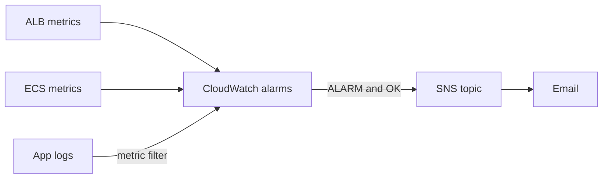

# Phase 5: Monitoring and Alerting

**Goal:** find out the app is broken from an alert, not from a user.
CloudWatch alarms watch each environment's availability, errors, and
resources, and notify an SNS topic that emails me.

**Pull requests:** #43 (alerts and first alarms), #44 and #47 (alarm
fixes), #46 (saturation and log alarms, dashboard), plus this wrap-up.

**Result:** every environment gets six alarms and a dashboard, created and
destroyed with it. A failure test proved the path end to end: taking the app
down produced an `ALARM` email within about 3 minutes, and restoring it
produced an `OK` email.

## Results

| | Before | After |
| --- | --- | --- |
| How I'd find out the app is down | Checking it myself, or a user telling me | Email from CloudWatch through SNS, about 3 minutes into an outage |
| Alarms per environment | 0 | 6: no healthy targets, ALB 5xx, app 5xx, CPU, memory, sign-in errors from logs |
| Recovery notice | n/a | Every alarm also emails on `OK` |
| Dashboards | 0 | One per environment: requests, p95 latency, 5xx, healthy targets, CPU and memory, sign-in errors |
| Alarms proven by breaking things | n/a | 2 of 6 (`alb-5xx`, `no-healthy-targets`) in a failure test |
| Alarm bugs found and fixed | n/a | 2: wrong dimensions (`INSUFFICIENT_DATA` forever) and missing data during an outage |
| AWS spend in October, all phases | n/a | $1.68 (budget data, which lags about a day) |

## Design

| Piece | Lives in | Why |
| --- | --- | --- |
| SNS topic and email subscription | `infra/bootstrap` (long-lived) | An email subscription has to be confirmed once by clicking a link. Recreating it nightly would mean confirming every day |
| Alarms (and dashboard) | `infra/modules/app` (per environment) | They watch resources that only exist while the environment exists, so they're created and destroyed with it. No orphaned alarms |

The module finds the topic by name with a data source, the same way it finds
ECR, the Route 53 zone, and the certificate. The deploy and teardown roles got
the CloudWatch and SNS permissions **before** the first deploy that needed
them, instead of finding out from an AccessDenied as in Phase 4.

## Progress

### Step 1: SNS topic and email

`code-fast-saas-alerts` with an email subscription (reusing the budget alert
address, which stays a `sensitive` variable). I confirmed the subscription,
then sent a test message with `aws sns publish` to prove the path to my inbox
worked before any alarm depended on it.

### Step 2: Availability and error alarms

| Alarm | Metric | Fires when |
| --- | --- | --- |
| `<env>-no-healthy-targets` | `HealthyHostCount` (`Minimum`) | Below 1 for 2 consecutive minutes |
| `<env>-alb-5xx` | `HTTPCode_ELB_5XX_Count` (`Sum`) | More than 5 in 5 minutes |
| `<env>-target-5xx` | `HTTPCode_Target_5XX_Count` (`Sum`) | More than 5 in 5 minutes |

Every alarm notifies the topic on both `ALARM` and `OK`, so a recovery is
announced too. The 5xx alarms treat missing data as not breaching, because no
traffic means no data points, and that isn't a problem.

### Steps 3–5: Saturation, logs, and a dashboard

| Alarm | Source | Fires when |
| --- | --- | --- |
| `<env>-cpu-high` | `AWS/ECS` `CPUUtilization` (`Average`) | Above 80% for two 5-minute periods |
| `<env>-memory-high` | `AWS/ECS` `MemoryUtilization` (`Average`) | Above 80% for two 5-minute periods |
| `<env>-auth-errors` | `AuthErrors`, a custom metric from a log metric filter | More than 5 in 5 minutes |

The log metric filter counts every app log line containing `[auth][error]`.
The pattern is wrapped in double quotes, because unquoted square brackets
mean space-delimited fields in CloudWatch's filter syntax.

Each environment also gets a CloudWatch dashboard (the first three per
account are free, one per environment) with the four golden signals:
requests, p95 latency, ALB and app 5xx, healthy targets, ECS CPU and memory,
and sign-in errors from the logs. After deploying, all six alarms were `OK`.

### Step 6: Breaking it on purpose

I scaled the dev service to zero tasks
(`aws ecs update-service --desired-count 0`), sent 20 requests (all `503`),
and waited for the alerts.

- **First run:** `alb-5xx` fired (`20.0 was greater than the threshold
  (5.0)`) and emailed me, then recovered with an `OK` email after I restored
  the service. `no-healthy-targets`, the alarm meant for exactly this
  outage, **never fired**. See Problem 2.
- **After the fix:** the same test sent `ALARM: code-fast-saas-dev-no-healthy-targets`
  about 3 minutes into the outage, and an `OK` email about 5 minutes after I
  scaled back to one task.

Scaling by hand created drift from the Terraform code (`desired_count = 1`),
so I restored it right after the test. Otherwise the next deploy would have
silently reset it.

## Problems I Solved

### 1. An alarm that could never fire

- **Problem:** after the first deploy, the 5xx alarms were `OK`, but `no-healthy-targets` stayed in `INSUFFICIENT_DATA` even though the app answered with 200. (A deliberate debugging exercise.) If the app had gone down, this alarm would have stayed silent.
- **Cause:** a CloudWatch metric is identified by its exact set of dimensions. The ALB publishes `HealthyHostCount` with `TargetGroup` **and** `LoadBalancer` together (plus a per-AZ variant). The alarm only specified `TargetGroup`, so it asked for a metric that doesn't exist. CloudWatch doesn't report an error for that; the alarm just never gets data.
- **Fix:** added `LoadBalancer = aws_lb.main.arn_suffix`. After the deploy, all three alarms were `OK`.
- **Side lesson:** `list-metrics` returned 23 `HealthyHostCount` metrics, most from environments I had already destroyed. Every rebuild gets new target group and load balancer IDs, and CloudWatch keeps metrics visible for about 15 days. Filtering by the current target group's ID showed the real dimension sets. This is also why alarms are built in Terraform from `arn_suffix` instead of hardcoded IDs.

### 2. The outage alarm stayed silent during an outage

- **Problem:** with the service scaled to zero, `no-healthy-targets` went from `OK` to `INSUFFICIENT_DATA` instead of `ALARM`, and sent nothing. (Found by the failure test, not planned.)
- **Cause:** pulling the metric for the outage window showed one data point per minute while the app was up, and **none at all** while it was down. With no registered targets, the ALB stops publishing `HealthyHostCount` instead of reporting 0. The alarm used the default `treat_missing_data = "missing"`, so the exact situation it was meant to catch produced no data and no alert.
- **Fix:** `treat_missing_data = "breaching"`. For a health metric, missing data means nothing is running. Re-running the test produced the `ALARM` email and then the `OK` email.

## What I Learned

- Test the notification path before relying on it. An unconfirmed email
  subscription drops every alert silently.
- `INSUFFICIENT_DATA` on an alarm for a running service usually means the
  alarm's namespace, metric name, or dimensions don't match a real metric.
  Compare the alarm's dimensions with `list-metrics` output, names as well as
  values.
- An alarm that can't fire is worse than no alarm, because it looks like
  coverage. Every alarm should be tested by breaking the thing it watches.
- Choose `treat_missing_data` per metric: no data is good news for an error
  count, but bad news for a health metric.
- A failure test is the only way to know an alarm works. Mine found a gap
  that reading the code and seeing `OK` hadn't.
- Some metrics stop being published instead of dropping to zero. Check what
  a metric does in the failure you care about before choosing
  `treat_missing_data`.
- GitHub's scheduled workflows run late when GitHub is busy. The 07:00 UTC
  teardown actually started between 11:20 and 11:55 UTC.

## Known Issues and Follow-ups

- **Email is the only notification channel.** A real team would route
  alerts to Slack or a paging tool (PagerDuty, Opsgenie) and treat prod
  differently from dev. Adding a subscriber to the SNS topic doesn't require
  changing any alarm.
- **Only two alarms have been failure-tested.** CPU, memory, app 5xx, and
  the log alarm should each get their own test (for example, an endpoint
  that deliberately returns 500s, or a load test for CPU).
- **No latency alarm.** p95 latency is on the dashboard but doesn't alert.
  A threshold needs real traffic to set it sensibly.
- **Ephemeral environments make some alert noise.** A new environment's
  alarms send `OK` emails as they get their first data, and
  `no-healthy-targets` can briefly alarm during a first deploy or a
  teardown, before the task is healthy or after it's gone. Options include
  disabling alarm actions during deploys and teardowns, or only notifying
  for prod.
- **Every environment has the same thresholds.** Prod might page sooner,
  while dev might not alert at all. That could become a module variable.
- **No uptime check from outside AWS.** All alarms come from inside AWS. A
  synthetic check (Route 53 health check or CloudWatch Synthetics) would
  catch DNS or certificate problems that AWS's own metrics can't see.
- **Logs are kept 7 days** and are only searched by one metric filter.
  CloudWatch Logs Insights queries and structured (JSON) app logs would make
  incidents faster to investigate.
