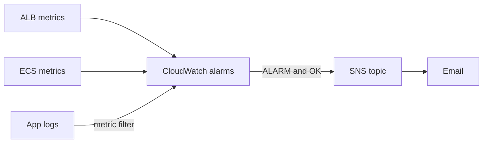

# Phase 5: Monitoring and Alerting

**Goal:** find out the app is broken from an alert, not from a user.
CloudWatch alarms watch each environment's availability, errors, and
resources, and notify an SNS topic that emails me.

**Status:** in progress.

## Design

| Piece | Lives in | Why |
| --- | --- | --- |
| SNS topic and email subscription | `infra/bootstrap` (long-lived) | An email subscription has to be confirmed once by clicking a link. Recreating it nightly would mean confirming every day |
| Alarms (and dashboard) | `infra/modules/app` (per environment) | They watch resources that only exist while the environment exists, so they're created and destroyed with it. No orphaned alarms |

The module finds the topic by name with a data source, the same way it finds
ECR, the Route 53 zone, and the certificate. The deploy and teardown roles got
the CloudWatch and SNS permissions **before** the first deploy that needed
them, instead of finding out from an AccessDenied as in Phase 4.

## Progress

### Step 1: SNS topic and email

`code-fast-saas-alerts` with an email subscription (reusing the budget alert
address, which stays a `sensitive` variable). I confirmed the subscription,
then sent a test message with `aws sns publish` to prove the path to my inbox
worked before any alarm depended on it.

### Step 2: Availability and error alarms

| Alarm | Metric | Fires when |
| --- | --- | --- |
| `<env>-no-healthy-targets` | `HealthyHostCount` (`Minimum`) | Below 1 for 2 consecutive minutes |
| `<env>-alb-5xx` | `HTTPCode_ELB_5XX_Count` (`Sum`) | More than 5 in 5 minutes |
| `<env>-target-5xx` | `HTTPCode_Target_5XX_Count` (`Sum`) | More than 5 in 5 minutes |

Every alarm notifies the topic on both `ALARM` and `OK`, so a recovery is
announced too. The 5xx alarms treat missing data as not breaching, because no
traffic means no data points, and that isn't a problem.

## Problems I Solved

### 1. An alarm that could never fire

- **Problem:** after the first deploy, the 5xx alarms were `OK`, but `no-healthy-targets` stayed in `INSUFFICIENT_DATA` even though the app answered with 200. (A deliberate debugging exercise.) If the app had gone down, this alarm would have stayed silent.
- **Cause:** a CloudWatch metric is identified by its exact set of dimensions. The ALB publishes `HealthyHostCount` with `TargetGroup` **and** `LoadBalancer` together (plus a per-AZ variant). The alarm only specified `TargetGroup`, so it asked for a metric that doesn't exist. CloudWatch doesn't report an error for that; the alarm just never gets data.
- **Fix:** added `LoadBalancer = aws_lb.main.arn_suffix`. After the deploy, all three alarms were `OK`.
- **Side lesson:** `list-metrics` returned 23 `HealthyHostCount` metrics, most from environments I had already destroyed. Every rebuild gets new target group and load balancer IDs, and CloudWatch keeps metrics visible for about 15 days. Filtering by the current target group's ID showed the real dimension sets. This is also why alarms are built in Terraform from `arn_suffix` instead of hardcoded IDs.

## What I Learned (so far)

- Test the notification path before relying on it. An unconfirmed email
  subscription drops every alert silently.
- `INSUFFICIENT_DATA` on an alarm for a running service usually means the
  alarm's namespace, metric name, or dimensions don't match a real metric.
  Compare the alarm's dimensions with `list-metrics` output, names as well as
  values.
- An alarm that can't fire is worse than no alarm, because it looks like
  coverage. Every alarm should be tested by breaking the thing it watches.
- Choose `treat_missing_data` per metric: no data is good news for an error
  count, but bad news for a health metric.
- GitHub's scheduled workflows run late when GitHub is busy. The 07:00 UTC
  teardown actually started between 11:20 and 11:55 UTC.
